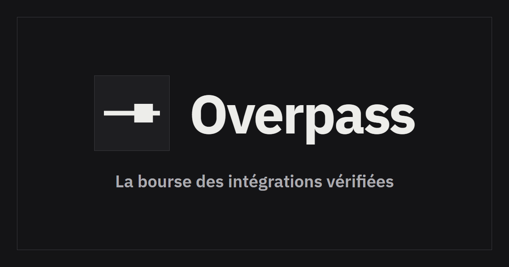

<p align="center">
  
</p>

<h1 align="center">Overpass</h1>

<p align="center">
  La bourse des intégrations africaines vérifiées : les développeurs y échangent ce que la documentation officielle ne dit pas.
</p>

<p align="center">
  Projet de l'équipe <strong>Ghostapi</strong> (Côte d'Ivoire) pour la Coupe d'Afrique des Développeurs, Systalink Challenge 2026, par Jude Koffi et Bradi.
</p>

<p align="center">
  <a href="https://getoverpass.app">getoverpass.app</a> ·
  <a href="https://getoverpass.app/fr/sandbox/demo">Démo sans compte</a> ·
  <a href="https://getoverpass.app/fr/docs">Documentation</a> ·
  <a href="LICENSE">Licence MIT</a>
</p>

---

## Pourquoi Overpass existe

Intégrer un paiement mobile money en Afrique de l'Ouest ressemble souvent à une enquête. Pour Orange Money, par exemple, l'accès technique est réservé aux marchands inscrits : avant d'avoir un compte, on n'a rien à lire. Pour les autres opérateurs, la documentation existe, mais elle ne dit pas ce qui se passe quand un webhook arrive deux fois ou quand l'opérateur ne répond pas à temps.

Ce savoir existe pourtant. Il circule dans des groupes WhatsApp, des fils Discord et la mémoire de quelques personnes. Rien n'y est daté ni vérifié, et tout se perd dès qu'un opérateur change son API.

Overpass est notre réponse à ce constat. Si l'information utile vient des développeurs qui ont déjà intégré un service en production, il faut un endroit où ils la déposent, où d'autres la confirment avec une date, et où l'on peut tester sans attendre trois semaines un compte marchand.

Le projet a été construit par l'équipe **Ghostapi** (Côte d'Ivoire) pour la Coupe d'Afrique des Développeurs, [Systalink Challenge 2026](https://systalink.com/fr/coupe-afrique-des-developpeurs-cadev), sur le thème « Construire la plateforme d'échange africaine, pour les devs, par les devs ».

## Ce que l'on fait sur Overpass

Le produit tient en trois briques centrales, entourées d'espaces communautaires. Les intégrations restent le cœur : l'accueil met le Simulateur et les fiches en premier, le reste vient ensuite.

### 1. Les itinéraires, des fiches d'intégration vérifiées

Un itinéraire est une fiche d'intégration pour un service, un pays et une stack donnés. Chaque fiche contient le code qui marche, les pièges connus (on les appelle des **nids-de-poule**) et la liste des vérifications faites par d'autres développeurs, chacune datée et rattachée à un pays.

Le catalogue se filtre par service, pays, stack et état. Par exemple, chercher « Wave, Sénégal, Laravel » mène directement à la fiche [02-wave-sn-laravel](apps/api/content/routes/02-wave-sn-laravel.md), qui explique la création d'une session Checkout, la vérification de la signature du webhook et l'exclusion de la route dans le middleware CSRF.

L'état d'une fiche n'est jamais saisi à la main, il est calculé à chaque lecture.

| État affiché | Règle |
| --- | --- |
| Voie libre | Au moins deux vérifications de comptes distincts dans les 90 derniers jours |
| À vérifier | Aucune vérification récente |
| Signalée cassée | Deux signalements non résolus ou plus |

On a longtemps hésité à stocker cet état en base. On a finalement choisi de le calculer, parce qu'une fiche peut passer de « voie libre » à « à vérifier » simplement parce que le temps passe, sans qu'aucune action ne déclenche de mise à jour.

Les dix fiches de départ couvrent Orange Money, Wave, PI-SPI, PayDunya, Moov Money et CinetPay, en Côte d'Ivoire, au Sénégal et au Bénin, pour Laravel, Node.js, PHP, Django, Next.js, Symfony et Flutter. Elles vivent dans [apps/api/content/routes](apps/api/content/routes). Un membre peut en publier de nouvelles à partir d'un modèle, les éditer en Markdown avec aperçu en direct, et chaque modification garde son historique de versions. Une fiche peut exister en français et en anglais, avec repli sur la langue disponible.

### 2. Les vérifications et les nids-de-poule

Sur chaque fiche, un bouton « Ça marche chez moi » ajoute une vérification datée, avec le pays et l'environnement (test ou production). Un même compte ne peut vérifier une fiche qu'une fois tous les 30 jours, sinon un seul enthousiaste suffirait à maintenir une fiche en « voie libre ».

Un bouton « Ça ne marche pas chez moi » ouvre une discussion déjà rattachée à la fiche, au service et au pays. Le formulaire a un champ pour le message d'erreur et un pour le code, et masque avant publication les clés, jetons et secrets collés par mégarde. Quand on est bloqué, il est très facile de coller un `.env` entier dans une question, et une clé publiée ne se reprend pas.

### 3. Le Simulateur de paiement mobile money

Le Simulateur rejoue les cas réels d'un paiement sans compte marchand. Les opérateurs simulés sont **non officiels**, construits uniquement à partir de leur documentation publique, sans logo.

| Opérateur | Documentation suivie |
| --- | --- |
| Wave | [Wave Checkout API](https://docs.wave.com/checkout) |
| PI-SPI (BCEAO) | [Portail développeur PI-SPI](https://developer.pispi.bceao.int) |
| PayDunya | [API HTTP/JSON](https://developers.paydunya.com/doc/FR/http_json) |
| CinetPay | [README du SDK PHP officiel](https://github.com/cinetpay/cinetpay-php-sdk) |

Orange Money et Moov Money n'ont pas de simulateur. Leur documentation technique n'est pas publique, et simuler une API qu'on ne peut pas lire reviendrait à inventer. Ils gardent leurs fiches, et un bouton « Je veux un simulateur » permet à chacun de voter pour qu'on en ajoute un.

Chaque opérateur répond aux cinq scénarios qui posent problème en production.

| Scénario | Ce qu'il permet de tester |
| --- | --- |
| `success` | Le chemin heureux, de la création au webhook |
| `insufficient_funds` | Le refus côté payeur et son message |
| `timeout` | Un opérateur qui ne répond pas à temps |
| `duplicate_webhook` | Le même webhook reçu deux fois, pour tester l'idempotence |
| `late_webhook` | Un webhook qui arrive bien après la redirection du client |

Les deux derniers sont les plus difficiles à reproduire à la main, et c'est pourtant là que se cachent les doubles encaissements et les commandes restées « en attente ».

**Essayer sans compte.** La [démo publique](https://getoverpass.app/fr/sandbox/demo) lance un paiement Wave simulé en moins de 30 secondes et affiche la requête, la réponse et le webhook.

**Appeler le simulateur depuis son code.** Une fois connecté, on crée une clé de test (`ovp_test_...`) dans le Simulateur. Les appels gardent le format exact de l'opérateur, seule l'adresse change. L'en-tête `Overpass-Scenario` choisit le scénario pour un appel donné.

```sh
curl https://getoverpass.app/v1/sandbox/wave/v1/checkout/sessions \
  -H "Authorization: Bearer ovp_test_xxxxxxxx" \
  -H "Content-Type: application/json" \
  -H "Overpass-Scenario: duplicate_webhook" \
  -d '{
    "amount": "1000",
    "currency": "XOF",
    "success_url": "https://exemple.africa/merci",
    "error_url": "https://exemple.africa/echec"
  }'
```

L'inspecteur montre ensuite chaque appel et chaque livraison de webhook, avec le code de réponse, la durée et un bouton « Rejouer ». Les secrets sont masqués dans l'historique, et les événements sont purgés au bout de 7 jours.

Le simulateur ne connaît aucun opérateur en dur. Chacun est un dossier dans [packages/providers](packages/providers) qui décrit ses points d'entrée, ses réponses par scénario, la forme et la signature de ses webhooks, et une fiche d'identité. Ajouter un opérateur ne touche ni l'API ni l'interface.

### 4. Recevoir les webhooks sur son ordinateur avec overpass-cli

Recevoir un webhook exige d'habitude une URL publique en HTTPS, donc un tunnel, un certificat ou un serveur de test. Sur une connexion instable, c'est souvent là que la journée s'arrête. La commande overpass-cli inverse le problème. Elle ouvre une connexion sortante vers Overpass et rejoue chaque webhook simulé sur le serveur local.

```sh
npx overpass-cli listen \
  --forward-to http://localhost:3000/webhooks/wave \
  --key ovp_test_xxxxxxxx \
  --api https://getoverpass.app
```

Le corps et les en-têtes arrivent octet pour octet, pour que la vérification de signature se comporte comme en production. Une clé ne reçoit que ses propres webhooks, et après une coupure la commande se reconnecte seule et récupère ce qu'il a manqué. Détails dans [apps/cli/README.md](apps/cli/README.md).

### 5. Le serveur MCP, pour les assistants de code

Le serveur MCP sert les fiches aux assistants de code (Claude Code, Cursor, VS Code), pour que l'IA du développeur écrive l'intégration locale à partir de ce qui a été vérifié, plutôt que de ce qu'elle croit savoir. Il est en lecture seule et n'embarque aucun modèle : chacun apporte le sien.

| Outil | Rôle |
| --- | --- |
| `search_routes` | Chercher des fiches par service, pays, stack et langue, avec leur état |
| `get_route` | Lire une fiche et la date de sa dernière vérification |
| `list_potholes` | Lister les pièges ouverts et confirmés |
| `list_services` | Lister les services et les pays couverts |

On crée un jeton personnel dans les paramètres du compte, puis la page de documentation donne la configuration prête à coller pour chaque éditeur. Pour Claude Code, cela donne :

```sh
claude mcp add --transport http overpass "https://getoverpass.app/mcp?lang=fr" \
  --header "Authorization: Bearer <votre jeton>"
```

Il suffit ensuite de demander à l'assistant, par exemple : « Intègre un paiement PayDunya dans mon projet Django pour la Côte d'Ivoire, en suivant la fiche Overpass ».

Le serveur MCP ne lit jamais la base, il passe par l'API comme n'importe quel client. Et parce qu'un texte écrit par un membre pourrait contenir des instructions déguisées, le contenu des fiches est renvoyé balisé comme une donnée, jamais comme une consigne pour l'assistant.

### 6. Autour du cœur, la communauté

- **Discussions.** Des sujets sur tout ce qui occupe un développeur africain, au-delà des intégrations : intégrations et API, cloud et déploiement, outils et IA, carrière et freelance, projets et entraide, événements et communautés. On peut voter « utile », accepter une réponse, et transformer une discussion résolue en fiche en un clic.
- **Blog.** Chaque membre a son blog à une adresse du type `/blog/@pseudo`, peut commenter et donner une étoile aux articles, et suivre des auteurs. Le fil « Pour moi » montre d'abord les auteurs suivis, puis les articles récents les mieux notés. Un flux RSS est disponible.
- **Newsletter.** Un résumé des meilleures fiches, discussions et articles, avec double confirmation et désinscription en un clic. Les liens de confirmation ouvrent une page qui appelle l'API en `POST`, parce que les antivirus de messagerie suivent les liens et auraient confirmé ou désinscrit à la place du lecteur.
- **Classement.** Des points par contribution (fiche publiée 10, vérification 2, piège confirmé 5, réponse acceptée 5, article publié 10), avec un classement par pays et par développeur. Les points sont calculés à partir des contributions, jamais saisis.
- **Demandes.** Un membre peut proposer un service absent de la liste, et voter pour un simulateur. Le classement des demandes est public.
- **Administration.** File de modération des fiches, sujets, articles et signalements, suspension de comptes ou de blogs. Deux signalements masquent un contenu en attendant une décision.

Toutes les pages existent en français et en anglais, avec des URL préfixées `/fr` et `/en`. Elles fonctionnent sur un écran de 360 px de large et au clavier seul.

## Les choix techniques, et pourquoi

Overpass est un monolithe modulaire en TypeScript : trois services légers derrière Caddy, une seule base PostgreSQL et un worker pour les webhooks.

| Couche | Choix |
| --- | --- |
| Interface | Preact, preact-iso, Vite 7, Tailwind CSS 3, i18next |
| API | Fastify, Zod, Drizzle ORM, node-postgres |
| Base et file d'attente | PostgreSQL 18, recherche plein texte native, `FOR UPDATE SKIP LOCKED` et `LISTEN/NOTIFY` |
| Serveur MCP | SDK officiel TypeScript |
| Tests | Vitest, Playwright |
| Déploiement | Docker Compose pour la base, systemd, Caddy |

Quelques décisions méritent d'être expliquées, parce qu'elles ne sont pas les choix par défaut.

- **Preact plutôt que React.** On visait un accueil utilisable en moins de 3 secondes sur une connexion 3G. React DOM pèse à lui seul 65 Ko compressés. En passant à Preact avec `@preact/compat`, la page vide est tombée de 98,6 Ko à 29,8 Ko de JavaScript compressé. Le budget est contrôlé à chaque build par `npm run check:budget`.
- **Vite 7 et Tailwind CSS 3, pas les dernières versions.** Vite 8 et Tailwind 4 dépendent de lightningcss, publié sous MPL-2.0, hors de notre liste de licences permissives. On a préféré rester une version en arrière plutôt que d'assouplir la règle.
- **PostgreSQL pour tout.** La recherche, la file d'attente des webhooks et les compteurs de limitation de débit vivent dans la même base. Pour une équipe de deux, chaque service en moins à exploiter est une nuit de sommeil en plus.
- **Des services sans état.** L'API, le worker et le serveur MCP peuvent être dupliqués derrière le proxy le jour où le trafic l'exige, sans réécriture.
- **Aucun service propriétaire dans le produit.** Pas d'authentification hébergée, pas d'API d'IA payante, pas de CDN. Les polices IBM Plex et les icônes Lucide sont auto-hébergées.

Le détail complet est dans le [cahier des charges](docs/cahier-des-charges.md), qui reste la source de vérité du projet.

## Démarrer en local

Il faut Node.js 22.18 ou plus récent, et PostgreSQL 18 (Docker Compose le fournit).

```sh
cp .env.example .env      # puis renseigner POSTGRES_PASSWORD et SESSION_SECRET
npm install
npm run db:up             # PostgreSQL avec Docker Compose
npm run db:migrate
npm run dev:api           # API sur 127.0.0.1:3000
npm run dev:worker        # envoi des webhooks simulés
npm run dev:web           # site sur 127.0.0.1:5173
npm run dev:mcp           # serveur MCP sur 127.0.0.1:3100
```

En développement, laissez `SMTP_HOST` vide : les liens de confirmation et de réinitialisation sont alors écrits dans les journaux de l'API.

### Une base prête à l'emploi

Le seed applique les migrations, crée ou promeut le compte équipe, puis écrit le contenu de départ attribué à ce compte : les dix fiches, un sujet d'accueil par thème et cinq articles, en français et en anglais. Il peut être relancé sans créer de doublon.

```sh
npm run db:seed -- --admin-email equipe@example.africa --content-dir apps/api/content
```

`SEED_ADMIN_PASSWORD` ne sert qu'au premier lancement, pour créer le compte équipe. Ensuite le seed n'en demande plus. Sans `--content-dir`, seuls les migrations, le compte et les gabarits vides de fiches sont écrits. Le contenu vit dans [apps/api/content](apps/api/content), un fichier Markdown par fiche, sujet ou article, avec ses champs en tête.

### Commandes utiles

| Commande | Effet |
| --- | --- |
| `npm run check` | Typage, lint, formatage, tests avec couverture, règles du dépôt et budgets de poids. La CI lance la même commande |
| `npm run test:e2e` | Tests de bout en bout Playwright |
| `npm run check:repo` | Absence de tiret cadratin, 200 lignes par fichier, 20 % de commentaires au plus, imports profonds, audit des licences |
| `npm run licenses` | Audit des licences et réécriture de [docs/LICENSES.md](docs/LICENSES.md) |
| `npm run openapi` | Génération de la spécification OpenAPI depuis les schémas Zod |
| `npm run build` | Compilation des paquets et des applications |

## Organisation du dépôt

| Dossier | Contenu |
| --- | --- |
| [apps/api](apps/api) | API Fastify, un dossier par module (comptes, fiches, vérifications, Simulateur, discussions, blog, newsletter, classement, demandes, administration), migrations SQL et contenu de départ |
| [apps/web](apps/web) | Site Preact bilingue |
| [apps/mcp](apps/mcp) | Serveur MCP en lecture seule, qui passe par l'API |
| [apps/cli](apps/cli) | Commande `overpass-cli`, qui fait arriver les webhooks du Simulateur sur l'ordinateur du développeur |
| [packages/shared](packages/shared) | Schémas Zod et types partagés |
| [packages/simulator](packages/simulator) | Moteur de scénarios et contrat commun des opérateurs |
| [packages/providers](packages/providers) | Un dossier par opérateur simulé |
| [docs](docs) | Cahier des charges, OpenAPI, licences, journal de l'usage de l'IA, procédure de déploiement |

Chaque module de l'API suit la même forme (`routes.ts`, `service.ts`, `repository.ts`, `schemas.ts`, `index.ts`) et n'est importable que par son `index.ts`. Aucune logique métier ne vit dans un composant ni dans un gestionnaire de route.

## Les règles que l'on s'est imposées

On a écrit ces règles le premier jour, en sachant qu'à deux et en deux semaines, la tentation de les contourner viendrait vite. La plupart sont donc vérifiées par la machine plutôt que par la bonne volonté.

- Licences permissives uniquement (MIT, Apache 2.0, BSD, ISC, licence PostgreSQL), dépendances indirectes comprises. Le rapport est dans [docs/LICENSES.md](docs/LICENSES.md).
- 200 lignes au plus par fichier, 40 par fonction, et des commentaires qui expliquent le pourquoi, jamais le quoi.
- Aucun texte d'interface écrit dans le code : tout passe par les fichiers de traduction français et anglais.
- Aucun tiret cadratin, nulle part, contrôlé automatiquement.
- Les webhooks du Simulateur ne visent jamais une adresse privée ou locale du serveur.
- Mots de passe hachés avec Argon2, cookies de session `httpOnly` et `SameSite=Lax`, contrôle de l'en-tête `Origin`, limitation de débit par IP et par adresse e-mail.
- Chaque modification faite avec l'aide d'une IA est consignée dans [docs/AI_USAGE.md](docs/AI_USAGE.md).

Le design suit [DESIGN.md](DESIGN.md), et les règles de code pour les assistants sont dans [CLAUDE.md](CLAUDE.md).

## Mise en production

L'instance publique tourne sur un serveur cloud Systalink, sous [getoverpass.app](https://getoverpass.app). Toute mise en production suit [docs/DEPLOYMENT.md](docs/DEPLOYMENT.md) : organisation du serveur, déploiement courant, mise à jour du hash CSP, seed et retour arrière.

## Ce qui reste à faire

On préfère le dire franchement plutôt que de le laisser deviner.

- Les paiements réels et la facturation : la page de tarifs présente les offres, sans encaissement.
- Le transfert des callbacks d'opérateurs réels vers l'ordinateur du développeur, prévu en bêta avec des quotas stricts.
- L'assistant « Demande à Overpass », qui chercherait dans les fiches et citerait ses sources, avec un modèle ouvert auto-hébergé.
- Des simulateurs pour Orange Money et Moov Money, dès qu'une documentation technique publique existera.

## Équipe et licence

Overpass est développé par **Ghostapi**, Côte d'Ivoire : Jude Koffi et Bradi.

Le code est sous licence [MIT](LICENSE), © 2026 Ghostapi. Les composants tiers gardent leur propre licence, toutes permissives (voir [docs/LICENSES.md](docs/LICENSES.md)). Les polices IBM Plex sont sous SIL Open Font License 1.1.

Les opérateurs simulés sont non officiels. Wave, PI-SPI, PayDunya, CinetPay, Orange Money et Moov Money sont des marques de leurs propriétaires respectifs, sans lien avec ce projet.

Une erreur dans une fiche, un piège que vous avez rencontré, une idée ? Ouvrez une [issue](https://github.com/kjlinux/overpass/issues), ou mieux, publiez-le directement sur [getoverpass.app](https://getoverpass.app).
